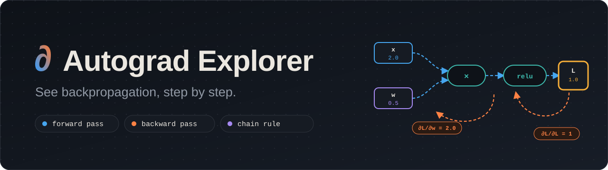
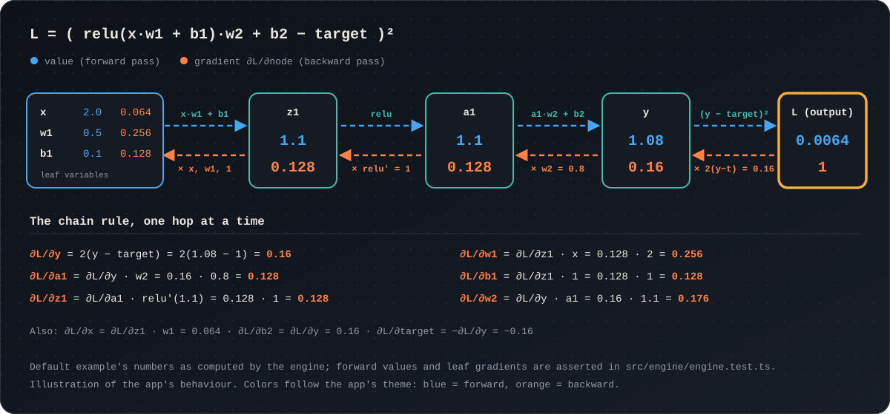
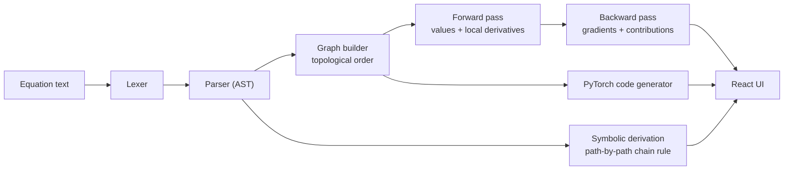

<div align="center">



<br />

**Write an equation. Watch it become a graph. Watch the gradients flow back.**

An interactive playground for understanding automatic differentiation, the chain rule and backpropagation, one step at a time.

<br />


</div>

---

## Why I built this

I built Autograd Explorer to **visualise what I was learning about autograd** and to make it easier to understand.

Reading that "backprop multiplies local derivatives backwards through the graph" is one thing. Actually *watching* each value get computed, then watching each gradient travel back along each arrow, is another. So this is a tool where you can type any small equation, see exactly how it works, and compare the result with PyTorch.

If you're learning how neural networks train, I hope it helps you too.

## Contents

- [What it does](#what-it-does)
- [See it in action](#see-it-in-action)
- [Quick start](#quick-start)
- [How to use it](#how-to-use-it)
- [Built-in lessons and examples](#built-in-lessons-and-examples)
- [Supported operations](#supported-operations)
- [How it works](#how-it-works)
- [Testing](#testing)
- [Tech stack](#tech-stack)
- [Project structure](#project-structure)
- [Deployment](#deployment)
- [Roadmap ideas](#roadmap-ideas)
- [Author](#author)
- [License](#license)

---

## What it does

| | |
| --- | --- |
| **Equations to graph, instantly** | Type lines like `z = x * w + b`. A computational graph is built as you type, with live, plain-language error messages (missing brackets, unknown functions, circular dependencies, names defined twice). |
| **Animated forward pass** | Press **Forward** and values flow left to right. Every box fills in as its value is computed. |
| **Animated backward pass** | Press **Backward** and gradients flow right to left. Each arrow shows exactly how much gradient it carried. |
| **Single-step mode** | Press **Step** (or the `.` key) to advance one node at a time. A caption narrates each step: *incoming gradient × local derivative = contribution*. |
| **Click anything to understand it** | Variables, operations and arrows all explain themselves in the inspector: value, gradient, local derivative, and the rule behind it. |
| **Step-by-step chain rule** | The **Derivation** tab enumerates every path from a variable to the output, expands each factor in LaTeX, plugs in the numbers, and adds the paths up. Hover a path to highlight it on the canvas. |
| **Gradient accumulation, visible** | When a variable is used more than once, you see each contribution and their sum. |
| **PyTorch parity** | The **PyTorch** tab generates runnable code for your graph, honouring `requires_grad`, with an option for `retain_grad()` on intermediates. Copy it, run it, and compare. |
| **Honest about edge cases** | `log(-1)`, `1/0` and `sqrt(-4)` are flagged where they happen. A variable that doesn't reach the output has *no gradient*, which is not the same as a gradient of 0, and the app keeps the two apart. |
| **Learn and Explore modes** | *Learn* gives simple explanations and 3-digit numbers. *Explore* gives fuller formulas and 6-digit precision. |
| **Six guided lessons** | From "What is a computational graph?" to "How does PyTorch use this?", each one loads an example and tells you what to try. |
| **Built to be used** | Light and dark themes, undo/redo, draggable nodes, minimap, auto-arrange, keyboard shortcuts, reduced-motion support, and a mobile layout. |

---

## See it in action

<p align="center">
  
</p>

The app opens on a tiny neuron with a squared loss:

```text
z1 = x * w1 + b1
a1 = relu(z1)
y  = a1 * w2 + b2
L  = (y - target)^2
```

with `x = 2`, `w1 = 0.5`, `b1 = 0.1`, `w2 = 0.8`, `b2 = 0.2`, `target = 1`.

1. **Forward:** `z1 = 1.1`, `a1 = 1.1`, `y = 1.08`, `L = 0.0064`.
2. **Backward:** start at `L` with gradient `1`, then multiply by each local derivative on the way back. `∂L/∂y = 2(y − target) = 0.16`, then `∂L/∂a1 = 0.16 × 0.8 = 0.128`, then `∂L/∂w1 = 0.128 × x = 0.256`.
3. **Check:** copy the generated PyTorch, run `L.backward()`, and `w1.grad` prints the same number.

The diagram above is an illustration of the app's behaviour. The numbers are the engine's real output for this example.

---

## Quick start

**Requirements:** [Node.js](https://nodejs.org) 20.19 or newer, and npm.

```bash
git clone https://github.com/YOUR_USERNAME/equation-verifier.git
cd equation-verifier
npm install
npm run dev
```

Then open the URL Vite prints (usually <http://localhost:5173>).

### Scripts

| Command | What it does |
| --- | --- |
| `npm run dev` | Start the dev server with hot reload |
| `npm run build` | Create a production build in `.output/` |
| `npm start` | Run the production build (Node server) |
| `npm run preview` | Preview the build with Vite |
| `npm test` | Run the test suite once |
| `npm run test:watch` | Run tests in watch mode |
| `npm run typecheck` | Type-check the whole project with `tsc` |
| `npm run lint` | Lint with ESLint |
| `npm run format` | Format with Prettier |

---

## How to use it

### 1. Write equations (left panel → *Equations*)

One definition per line, in the form `name = expression`. Press **Apply changes** (or `Ctrl/Cmd + Enter`) to build the graph.

```text
a = x * w
y = a + b
```

- Operators: `+  -  *  /  ^` (and `**` as an alternative to `^`), plus parentheses and unary minus.
- Functions: `relu  sigmoid  tanh  exp  log  sqrt  sin  cos  abs  square`, always written with brackets, like `relu(z)`.
- Numbers can use scientific notation: `1e-3`.
- Any name you *use* but never define becomes a **leaf variable**.
- Every name can be defined once, and definitions can't be circular.
- Numbers written inline (the `3` in `y = 3 * x`) are literals and don't get gradients.

### 2. Configure variables (left panel → *Variables*)

Each leaf variable can be an **input**, a **parameter** or a **constant**. Set its value with a slider or a number field, and toggle `requires_grad`. Pick which output to differentiate. Everything recomputes live.

New leaf names get sensible defaults: names starting with `w`, `b`, `theta`, `W` or `bias` become trainable parameters; `t`, `target`, `y_true` and `label` become constants; everything else is an input.

### 3. Run the passes (top bar)

| Control | What it does |
| --- | --- |
| **Forward** | Animate values flowing from inputs to the output |
| **Backward** | Animate gradients flowing from the output back to every input |
| **Step** | Advance one node at a time, with a narrated caption |
| **Reset** | Return to the original example |
| **Undo / Redo** | Step through your history of edits |
| **Learn / Explore** | Switch between simple and detailed explanations |

### 4. Inspect (right panel)

| Tab | Shows |
| --- | --- |
| **Explain** | The selected variable, operation or arrow: its value, gradient, local derivatives and the rule behind them |
| **Derivation** | The chain rule for the selected variable, path by path, in LaTeX with numbers substituted |
| **PyTorch** | Generated, runnable PyTorch code for your graph |

### 5. Work the canvas

Drag nodes to rearrange them (this never changes the maths), drag the background to pan, scroll to zoom. The canvas controls let you fit the view, centre on a selection, auto-arrange, and choose what to show (values, gradients, forward arrows, backward contributions). You can also highlight the ancestors, descendants, or paths-to-output of a selected node.

### Keyboard shortcuts

| Keys | Action |
| --- | --- |
| `.` | Step through the forward and backward pass |
| `F` | Fit the graph to the screen |
| `Ctrl/Cmd + Z` | Undo |
| `Ctrl/Cmd + Shift + Z` or `Ctrl/Cmd + Y` | Redo |
| `Ctrl/Cmd + Enter` or `Shift + Enter` (in the editor) | Apply equation changes |

---

## Built-in lessons and examples

### Lessons

Open the **Lessons** tab for a guided path. Each lesson loads its own example and gives you things to try.

| # | Lesson | Idea |
| --- | --- | --- |
| 1 | What is a computational graph? | Boxes are values, pills are operations, arrows are dependencies |
| 2 | What is a derivative? | How much the output moves when you nudge the input |
| 3 | What is the chain rule? | Multiply the effects along a path |
| 4 | What is backpropagation? | One backward sweep gives every gradient at once |
| 5 | Why do gradients accumulate? | A value used twice receives two contributions that add |
| 6 | How does PyTorch use this? | `requires_grad`, `grad_fn`, `.backward()` and `.grad` |

### Example graphs

| Example | Equations |
| --- | --- |
| Tiny neuron with squared loss *(default)* | `z1 = x * w1 + b1` · `a1 = relu(z1)` · `y = a1 * w2 + b2` · `L = (y - target)^2` |
| Linear | `y = x * w + b` |
| A single derivative | `y = 3 * x` |
| Chain rule | `a = x * w` · `y = a + b` |
| Two paths (accumulation) | `u = x * w` · `v = x + b` · `y = u * v` |
| Logistic regression (2 features) | `z = w1 * x1 + w2 * x2 + b` · `p = sigmoid(z)` · `L = -(t * log(p) + (1 - t) * log(1 - p))` |

---

## Supported operations

Every operation knows its forward function, its local partial derivatives, and how to explain itself. These are the rules the engine applies.

| Operation | Syntax | Local derivative(s) |
| --- | --- | --- |
| Add | `a + b` | `1`, `1` |
| Subtract | `a - b` | `1`, `−1` |
| Multiply | `a * b` | `b`, `a` |
| Divide | `a / b` | `1/b`, `−a/b²` |
| Power | `a ^ b` | `b·aᵇ⁻¹`, `aᵇ·ln a` (needs `a > 0`) |
| Negate | `-a` | `−1` |
| ReLU | `relu(x)` | `1` if `x > 0`, else `0` (0 at exactly 0, like PyTorch) |
| Sigmoid | `sigmoid(x)` | `σ(x)·(1 − σ(x))` |
| Tanh | `tanh(x)` | `1 − tanh²(x)` |
| Exp | `exp(x)` | `eˣ` |
| Log | `log(x)` | `1/x` (needs `x > 0`) |
| Square root | `sqrt(x)` | `1/(2√x)` (needs `x ≥ 0`) |
| Sine | `sin(x)` | `cos(x)` |
| Cosine | `cos(x)` | `−sin(x)` |
| Absolute value | `abs(x)` | `sign(x)` (0 at exactly 0, like PyTorch) |
| Square | `square(x)` | `2x` |

---

## How it works

The project is split into a **pure TypeScript engine** (no UI code, fully testable) and a **React interface** that renders what the engine computes.



Key design choices:

- **Two independent ways to compute every gradient.** The animation uses reverse-mode autodiff (what PyTorch does). The Derivation tab uses *symbolic* path enumeration. The tests assert that the two agree to 10 decimal places, so each method checks the other.
- **The UI never hard-codes a result.** Every number, formula and explanation comes from the engine.
- **Layout is separate from maths.** Node positions are stored apart from equations and values, so recomputing never moves a node and dragging a node never changes the maths.
- **Error messages are written for learners.** "`foo` isn't a known function. Try one of: relu, sigmoid, …" beats a stack trace.
- **Edge cases are modelled, not hidden.** Undefined derivatives, disconnected variables and circular definitions are all detected and explained.

For a full walkthrough, see **[docs/ARCHITECTURE.md](docs/ARCHITECTURE.md)**, including how to add a new operation.

### The generated PyTorch

For the default example, the PyTorch tab produces (with `retain_grad` enabled):

```python
import torch

# Leaf tensors (values you set)
x = torch.tensor(2.0)  # input
w1 = torch.tensor(0.5, requires_grad=True)  # parameter
b1 = torch.tensor(0.1, requires_grad=True)  # parameter
w2 = torch.tensor(0.8, requires_grad=True)  # parameter
b2 = torch.tensor(0.2, requires_grad=True)  # parameter
target = torch.tensor(1.0)  # constant

# Forward pass — PyTorch records a grad_fn for each operation
z1 = x * w1 + b1
z1.retain_grad()  # keep .grad on a non-leaf
a1 = torch.relu(z1)
a1.retain_grad()  # keep .grad on a non-leaf
y = a1 * w2 + b2
y.retain_grad()  # keep .grad on a non-leaf
L = (y - target) ** 2.0

print("L =", L.item())

# Backward pass — fills .grad on leaf tensors with requires_grad=True
L.backward()

# x.grad is None — requires_grad is off for x
print("dL/dw1 =", w1.grad.item())
print("dL/db1 =", b1.grad.item())
print("dL/dw2 =", w2.grad.item())
print("dL/db2 =", b2.grad.item())
# target.grad is None — requires_grad is off for target
print("dL/dz1 =", z1.grad.item())
print("dL/da1 =", a1.grad.item())
print("dL/dy =", y.grad.item())
```

---

## Testing

```bash
npm test
```

The engine test suite (`src/engine/engine.test.ts`, 17 tests) covers:

- **The default example**: forward values, every leaf gradient, and agreement between autodiff and the symbolic derivation
- **Arithmetic and division** gradients
- **Gradient accumulation**: `y = x * x`, branching graphs, and shared intermediate nodes
- **All activation and math functions** against hand-derived analytic values
- **PyTorch conventions** for `relu` at 0
- **Invalid domains**: `log` of a negative, division by zero
- **Disconnected variables** (no gradient) versus a **zero gradient**
- **Circular dependency detection**
- **Operator precedence** and unary negation
- **Friendly parser errors**

`src/test/app-routing.test.tsx` checks that the home route resolves.

---

## Tech stack

| Layer | Technology |
| --- | --- |
| Framework | [TanStack Start](https://tanstack.com/start) + [TanStack Router](https://tanstack.com/router) (file-based routing, SSR) |
| UI | [React 19](https://react.dev), [Tailwind CSS 4](https://tailwindcss.com), [shadcn/ui](https://ui.shadcn.com) on [Radix UI](https://www.radix-ui.com), [Lucide](https://lucide.dev) icons |
| Graph canvas | [React Flow (`@xyflow/react`)](https://reactflow.dev) |
| Maths rendering | [KaTeX](https://katex.org) |
| Language | [TypeScript](https://www.typescriptlang.org) (strict mode) |
| Build and server | [Vite](https://vite.dev) + [Nitro](https://nitro.build) |
| Testing | [Vitest](https://vitest.dev) + Testing Library |
| Code quality | ESLint + Prettier |

---

## Project structure

```text
.
├── docs/
│   ├── ARCHITECTURE.md        # engine and UI design, how to extend it
│   └── assets/                # README banner and diagram
├── public/                    # favicon, robots.txt
└── src/
    ├── engine/                # the maths: pure TypeScript, no UI imports
    │   ├── lexer.ts           #   text → tokens
    │   ├── parser.ts          #   tokens → AST, with friendly errors
    │   ├── graphBuilder.ts    #   AST → computational graph, topological sort
    │   ├── operationRegistry.ts #  every operation: forward, derivative, explanation
    │   ├── autodiff.ts        #   forward and backward passes
    │   ├── symbolicDerivation.ts # path-by-path chain rule in LaTeX
    │   ├── pytorch.ts         #   PyTorch code generator
    │   ├── layout.ts          #   left-to-right graph layout
    │   └── engine.test.ts     #   engine test suite
    ├── components/
    │   ├── GraphCanvas/       #   React Flow canvas
    │   ├── GraphNode/ GraphEdge/  # node and edge rendering
    │   ├── EquationEditor/    #   live-validated equation input
    │   ├── VariableTable/     #   values, requires_grad, output picker
    │   ├── LearningInspector/ #   Explain tab
    │   ├── GradientDerivation/#   Derivation tab
    │   ├── PyTorchCodePanel/  #   PyTorch tab
    │   ├── ExecutionControls/ #   narrated step captions
    │   ├── CanvasToolbar/     #   zoom, fit, display options
    │   └── ui/                #   shadcn/ui primitives
    ├── hooks/useExplorer.tsx  # app state: document, history, playback
    ├── examples/              # example graphs
    ├── lessons/               # guided lessons
    ├── lib/                   # view helpers, utilities, error handling
    ├── routes/                # file-based routes
    ├── server.ts              # SSR entry with friendly error handling
    └── styles.css             # design tokens (light and dark)
```

---

## Deployment

```bash
npm run build   # production build in .output/
npm start       # serve it with Node
```

The build uses [Nitro](https://nitro.build), which targets Node by default and can be pointed at other platforms (Vercel, Netlify, Cloudflare and more) using its [deployment presets](https://nitro.build/deploy).

---

## Roadmap ideas

- Vector and matrix support (`matmul`, broadcasting) for layer-level graphs
- `softmax` and cross-entropy
- A gradient-descent loop: update parameters with `w ← w − lr · ∂L/∂w` and chart the loss
- Shareable links that encode a graph in the URL
- Export the graph as PNG or SVG
- More activations (leaky ReLU, GELU, softplus)
- Higher-order derivatives

---

## Author

**Swapnil Das**

[](https://www.linkedin.com/in/swapnil-das-603824236)

If this helped you understand autograd, a ⭐ on the repo means a lot.

## License

Released under the [MIT License](LICENSE).
