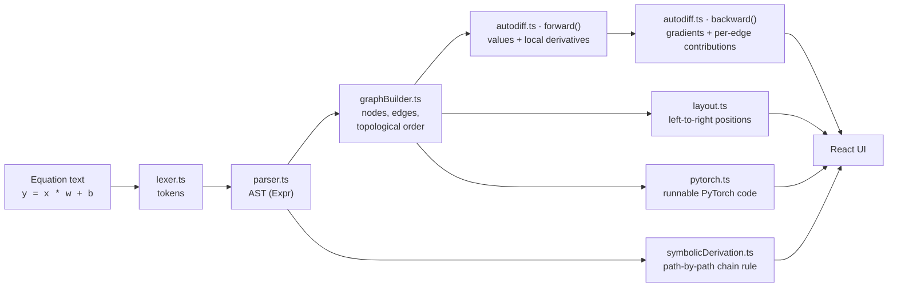

# Architecture

Autograd Explorer has two halves that are deliberately kept apart:

1. **The engine** (`src/engine`) is a pure TypeScript library. It parses equations, builds a computational graph, runs the forward and backward passes, derives gradients symbolically, and generates PyTorch code. It has **no UI imports**, so every result is deterministic and unit-testable.
2. **The interface** (`src/components`, `src/hooks`, `src/routes`) is a React app that renders whatever the engine computes and narrates it in plain language.

> **Golden rule:** the UI never hard-codes a result. Every number, formula and explanation you see on screen comes from the engine.

---

## The pipeline

| Stage | File | What it does |
| --- | --- | --- |
| Lexing | `lexer.ts` | Turns text into tokens (`num`, `ident`, `op`). Understands scientific notation (`1e-3`) and treats `**` as `^`. Throws `ParseError` with the exact character position. |
| Parsing | `parser.ts` | Recursive-descent parser producing an `Expr` AST. Precedence from loosest to tightest: `+ -`, `* /`, unary `-`, `^`. Error messages are written for learners ("`foo` isn't a known function. Try one of: …"). |
| Graph building | `graphBuilder.ts` | Converts equations into `GNode`s (variables, operations, literals) and `GEdge`s. Classifies variables as input, parameter, constant or intermediate. Runs a Kahn topological sort and reports circular dependencies and duplicate definitions. |
| Operation registry | `operationRegistry.ts` | One table describing every operation: forward function, analytic local partial derivatives, plain-language explanation, LaTeX for the formula and its derivative, and an optional domain check (e.g. `log` of a non-positive number). Adding an operation means adding one entry. |
| Forward pass | `autodiff.ts` | Evaluates nodes in topological order, records each edge's **local derivative**, and flags domain problems, NaN and infinity at the node where they start. |
| Backward pass | `autodiff.ts` | Seeds the output with gradient 1, walks the graph in reverse topological order, and for every edge computes `incoming gradient × local derivative`. Contributions to the same node are summed, which is exactly gradient accumulation. |
| Symbolic derivation | `symbolicDerivation.ts` | Differentiates expressions symbolically, simplifies them, enumerates **every dependency path** from a variable to the output, and expands each chain-rule factor into LaTeX (formula, substituted numbers, value). |
| PyTorch export | `pytorch.ts` | Emits runnable PyTorch for the current graph, respecting each variable's `requires_grad` and optionally adding `retain_grad()` for intermediates. |
| Layout | `layout.ts` | Layered left-to-right placement with barycentre ordering to reduce edge crossings. |

---

## Two independent ways to get a gradient

The app computes each gradient **twice, by different routes**:

- **Numerical reverse-mode autodiff** (`autodiff.ts`): local derivatives multiplied backwards through the graph. This is what the animation shows, and what PyTorch does.
- **Symbolic path enumeration** (`symbolicDerivation.ts`): finds each path from variable to output, differentiates each equation symbolically, multiplies the factors along the path, and adds the paths together.

The Derivation tab uses the second method to explain the first. The test suite asserts that the two agree to 10 decimal places on the default example (`symbolic path derivation agrees with autodiff`). If one approach were wrong, the other would expose it.

---

## Correctness decisions

These behaviours are intentional and covered by tests:

| Situation | Behaviour | Why |
| --- | --- | --- |
| `relu` at exactly 0 | derivative is `0` | Matches PyTorch's convention |
| `abs` at exactly 0 | derivative is `0` (`sign(0)`) | Matches PyTorch's convention |
| A variable that never reaches the output | reported as **no gradient (disconnected)** | "No path" is different from "gradient is 0", and the UI keeps them separate |
| A genuine zero gradient | shown as `0` and marked computed | Same reason, opposite case |
| `log(x)` with `x ≤ 0`, `sqrt` of a negative, `1/0`, a negative base with a fractional exponent | node flagged with a plain-language message; derivatives become `NaN` | Outside the domain the derivative is undefined, so the app says so instead of showing a misleading number |
| `a = b + 1` and `b = a * 2` | rejected with a "Circular dependency" message | A computational graph must flow in one direction |
| A name defined twice | rejected, pointing to the first definition | Each name is defined once |
| A variable used several times (`y = x * x`) | contributions are summed | This is the definition of gradient accumulation |

---

## The interface layer

State lives in a single context provider, `useExplorer` (`src/hooks/useExplorer.tsx`).

- **Document state** (`doc`) holds the equation lines, each variable's configuration (`value`, `kind`, `requiresGrad`) and the chosen output.
- **Derived state** is recomputed with `useMemo` whenever the document changes: `graph`, `fwd` (forward result), `bwd` (backward result) and `env` (variable → value map).
- **Positions are stored separately** from equations and values. Recomputing the math never moves a node, and dragging a node never changes the math. When the equations change, `mergePositions` keeps existing positions and lays out only the new nodes.
- **Undo / redo** keeps a bounded history of snapshots. Rapid edits to the same field are coalesced into one history entry (e.g. dragging a slider).
- **Playback** is a small state machine: `fStep` and `bStep` count how many forward and backward steps have been revealed, and a timer advances them. `useRunView` (`src/lib/graphView.ts`) converts those counters into "which values and gradients are visible right now", so animation, single-stepping and the finished state all use the same code path.
- **Reduced motion** is supported both through a toggle and through the `prefers-reduced-motion` media query.

### Component map

| Area | Components |
| --- | --- |
| Shell and layout | `AppShell`, `TopToolbar` (side panels on desktop, slide-over sheets on mobile) |
| Left panel | `EquationEditor` (live validation, syntax colouring, reordering), `VariableTable` (value sliders, `requires_grad`, output picker), `LessonsPanel` |
| Canvas | `GraphCanvas` (React Flow), `GraphNodes`, `FlowEdge`, `CanvasControls`, `StepCaption` |
| Right panel | `LearningInspector` (Explain tab), `GradientDerivation` (Derivation tab), `PyTorchCodePanel` (PyTorch tab) |
| Maths rendering | `Tex` (KaTeX) |

`src/components/ui` contains [shadcn/ui](https://ui.shadcn.com) primitives built on Radix UI.

### Content

- `src/examples/index.ts` defines the example graphs.
- `src/lessons/index.ts` defines the six guided lessons. Each lesson loads an example, can pre-select a node, open an inspector tab, and trigger a forward or backward run.

---

## Server and build

The app is built with [TanStack Start](https://tanstack.com/start) (file-based routing, SSR) on Vite.

- `vite.config.ts` wires up TanStack Start, React, Tailwind CSS v4, path aliases, and, for production builds, [Nitro](https://nitro.build).
- `src/server.ts` wraps the TanStack Start handler so unexpected SSR failures return a friendly error page instead of a raw 500. `src/lib/error-capture.ts` keeps the original stack trace for the server logs.
- `src/start.ts` registers request middleware (error handling and CSRF protection for server functions).
- The graph canvas renders client-side only (`ClientOnly`), because React Flow needs the browser.

---

## Extending the engine

**Add an operation** (for example `softplus`):

1. Add an entry to `defs` in `src/engine/operationRegistry.ts` with `forward`, `partials`, `latex`, `partialLatex`, and the two plain-language strings.
2. Add its name to `FUNCTIONS` so the parser accepts it.
3. In `symbolicDerivation.ts`, add a symbolic rule to the `call` case of `diff()` and a numeric entry to the `FN` table used by `evalExpr()`. Optionally add a `toLatex()` case; without one it falls back to `\operatorname{name}(…)`.
4. Add a PyTorch mapping in `pytorch.ts` if `torch.<name>` isn't the right spelling.
5. Add a test comparing the autodiff gradient to a hand-derived value.

**Add an example or lesson:** append to `EXAMPLES` or `LESSONS`. No other wiring is needed.
